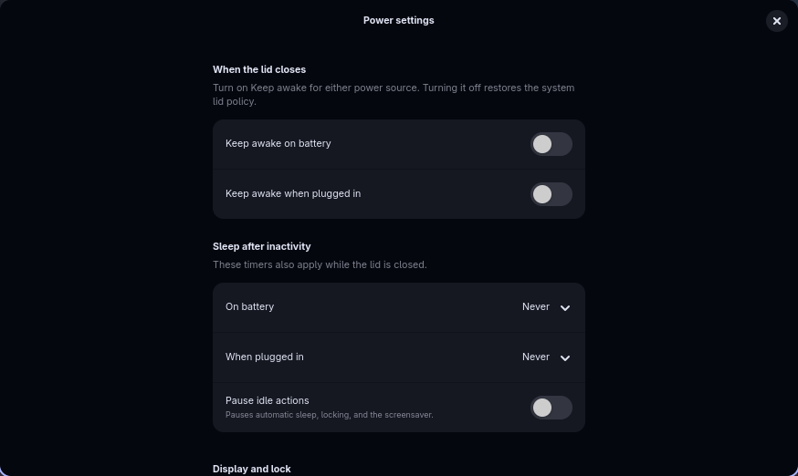

# Blue View Power Settings

Open the battery icon, choose **Power settings**, and select **Keep awake when plugged in**, **Keep awake on battery**, or both. To keep the laptop running indefinitely with the lid shut, also set **Sleep after inactivity** to **Never** for that power source.



## Install

This plugin is for laptops running Omarchy Quattro with the Quickshell battery panel, Wayland idle notifications, systemd-logind, UPower, and the Omarchy idle and power-profile commands. The settings window uses Python 3, PyGObject, GTK 4, and libadwaita. On Arch, the corresponding GUI packages are `python-gobject`, `gtk4`, and `libadwaita`. Screen brightness uses `brightnessctl` when a controllable backlight is available. Charge limiting requires battery firmware and a UPower version that support charge thresholds.

```bash
omarchy plugin add https://github.com/frank-blueview-ai/omarchy-power-settings
omarchy plugin enable bvos.power
```

Enabling the plugin replaces the stock battery widget when it is present. If you already run a custom battery clone, disable that clone first so only one widget handles the power-panel shortcut.

## Controls

| Control | Behavior |
| --- | --- |
| Keep awake on lid close | Overrides logind’s lid action for the selected power source while the plugin runs. Turning the switch off restores the system lid policy. |
| Sleep after inactivity | Sets a separate suspend timer for battery and AC power. The timer still applies when the lid is closed. |
| Pause idle actions | Pauses automatic sleep, the screensaver, and idle locking using Omarchy’s stay-awake setting. |
| Start screensaver and lock screen | Sets the two Omarchy idle timeouts independently. Choose **Never** to disable either timer. |
| Screen brightness | Sets the built-in backlight to a percentage. |
| Limit charging | Requests the thresholds reported by UPower. Available batteries appear separately. Firmware or system authorization can decline the change. |
| Power profile | Choose a profile directly in the battery popup. Omarchy remembers the choice for the current power source. |

## Settings and removal

Lid switches and automatic suspend default to off. Existing idle preferences are read from `~/.config/omarchy/shell.json`. Each change updates the relevant key under `idle`. The service uses a session-scoped `systemd-inhibit` lock for lid events and requests suspend through systemd when the chosen idle timeout expires. It needs no system configuration edits. For the current power source and live inhibitor state, run:

```bash
omarchy-shell bvos.power.policy status
```

To undo a change to brightness, idle locking, screensaver timing, power profile, or charge limiting, choose your preferred value before removal. These settings belong to the desktop or hardware and persist separately from the plugin.

```bash
omarchy plugin disable bvos.power
omarchy plugin remove bvos.power
```

Disabling the plugin releases its lid inhibitor and stops its automatic suspend timer. Omarchy restores the stock battery widget when the plugin replaced it.

## License

The plugin is distributed under the MIT license. The Omarchy battery panel and model retain their original MIT notice. [Blue View license](LICENSE) · [Omarchy license](LICENSE.omarchy)
